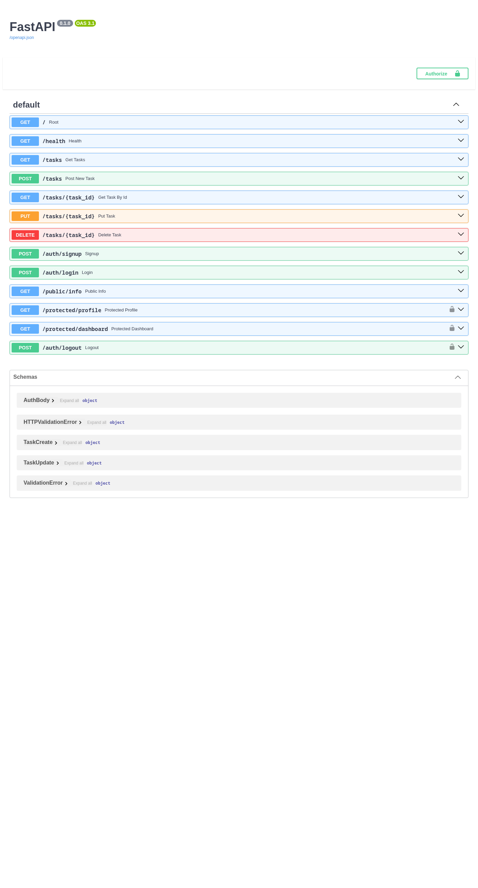

# Task API — with Supabase Auth

A FastAPI CRUD API for tasks backed by PostgreSQL in Docker, secured with **Supabase Auth**: sign up, log in, log out, and JWT-protected routes documented in Swagger UI.

## What this is

- REST endpoints to create, read, update, and delete tasks (`/tasks`)
- **Authentication**: `POST /auth/signup`, `POST /auth/login`, `POST /auth/logout`
- **Protected routes** guarded by a reusable dependency that verifies the Bearer JWT with Supabase
- PostgreSQL 16 in Docker; all database code lives in `repository.py`
- Interactive API docs with an **Authorize** padlock at `/docs`

## Environment variables

Copy `.env.example` to `.env` and fill in your own values (`.env` is git-ignored — never commit it):

| Variable         | Meaning                                             |
| ---------------- | --------------------------------------------------- |
| `DATABASE_URL`   | Postgres connection string                          |
| `SUPABASE_URL`   | Your Supabase project URL (no `/rest/v1/` suffix)   |
| `SUPABASE_KEY`   | Your Supabase **anon** public key                   |

Supabase setup (one time, free tier, no credit card): create a project at [supabase.com](https://supabase.com), copy **Project URL** and **anon key** from *Project Settings → Data API*, and turn **Authentication → Sign In / Providers → Email → Confirm email** OFF so test users can log in immediately.

## Run it

```bash
cp .env.example .env   # then fill in your values
docker compose up --build
```

Or, without Docker Compose for the app:

```bash
docker compose up -d db
uv run uvicorn main:app --port 3000
```

API at `http://localhost:3000` — interactive docs at `http://localhost:3000/docs`.

## Endpoints

| Method   | Path                  | Auth header                     | Status | Description |
| -------- | --------------------- | ------------------------------- | ------ | ----------- |
| `POST`   | `/auth/signup`        | —                               | `201`  | Create account · `400` missing fields |
| `POST`   | `/auth/login`         | —                               | `200`  | Returns `access_token` + `refresh_token` · `401` bad credentials |
| `POST`   | `/auth/logout`        | `Authorization: Bearer <token>` | `204`  | End session · `401` missing/invalid token |
| `GET`    | `/protected/profile`  | `Authorization: Bearer <token>` | `200`  | Own profile (`id`, `email`, `created_at`) |
| `GET`    | `/protected/dashboard`| `Authorization: Bearer <token>` | `200`  | Sample protected data (same guard, zero new auth code) |
| `GET`    | `/public/info`        | —                               | `200`  | Public open data |
| `GET`    | `/tasks`              | —                               | `200`  | List all tasks |
| `GET`    | `/tasks/{id}`         | —                               | `200`  | Get one task · `404` unknown id |
| `POST`   | `/tasks`              | —                               | `201`  | Create task · `400` blank title |
| `PUT`    | `/tasks/{id}`         | —                               | `200`  | Update task · `404` unknown id |
| `DELETE` | `/tasks/{id}`         | —                               | `204`  | Delete task · `404` unknown id |

All protected routes answer `401` with a JSON error when the token is **missing**, **malformed**, **invalid**, or **expired**.

## Auth flow

1. `POST /auth/signup` or `POST /auth/login` → Supabase returns a JWT
2. Send it on every protected call: `Authorization: Bearer <access_token>`
3. The `get_current_user` dependency asks Supabase `get_user(token)` — a real network call — and only then lets the route run
4. `POST /auth/logout` ends the session (`204`)

## Swagger UI



Click **Authorize**, paste your `access_token` from `/auth/login`, then **Try it out** on `GET /protected/profile` — no curl needed.

## Example

```bash
$ TOKEN=$(curl -s -X POST http://localhost:3000/auth/login \
    -H "Content-Type: application/json" \
    -d '{"email":"test@example.com","password":"password123"}' | python3 -c "import sys,json;print(json.load(sys.stdin)['access_token'])")

$ curl -i http://localhost:3000/protected/profile -H "Authorization: Bearer $TOKEN"
HTTP/1.1 200 OK
{"id":"...","email":"test@example.com","created_at":"..."}

$ curl -i http://localhost:3000/protected/profile
HTTP/1.1 401 Unauthorized
{"detail":{"error":"Access token required"}}
```
